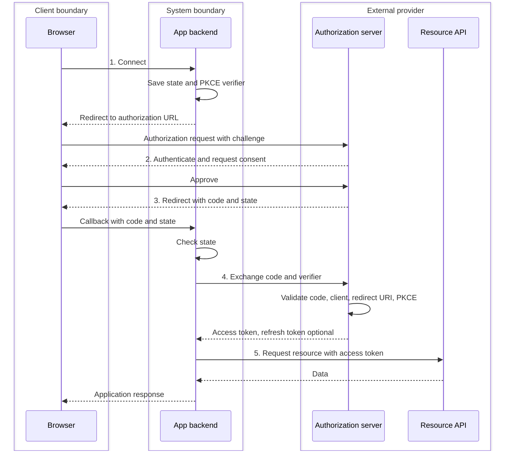

# OAuth 2.0 authorization code flow with PKCE

**Research question:** How does a web app obtain permission to call a user's external API, and which system owns each part of the exchange?

**Status:** Protocol research from primary specifications. No implementation or local behavior has been tested.

This note uses five steps to explain the **authorization code flow with PKCE**. OAuth 2.0 has other grant types; these five steps are a teaching outline, not a universal OAuth sequence. The example is a web app whose backend handles the OAuth exchange and calls the external API.

## Boundaries and roles

| Boundary | Component | Responsibility |
| --- | --- | --- |
| Client boundary | User's browser | Starts the connection, follows redirects, and displays the provider's sign-in and consent pages. In OAuth terminology, this is the **user agent**, not the OAuth client. |
| System boundary | Our app backend | The **OAuth client**. Starts the flow, checks the callback, exchanges the code, retains tokens, and calls the API. |
| External provider | Authorization server | Authenticates the user, handles consent, issues authorization codes, and exchanges valid codes for tokens. |
| External provider | Resource server | Hosts the protected API and accepts or rejects requests carrying access tokens. |

The authorization server and resource server can be separate services or part of the same provider. [RFC 6749, roles](https://www.rfc-editor.org/rfc/rfc6749.html#section-1.1)

## The five steps

1. **Request authorization.** The user selects “Connect” in the browser. Our backend creates a transaction-specific `state` value and PKCE `code_verifier`, binds them to the browser session, and redirects the browser to the provider's authorization endpoint. The request includes `response_type=code`, `client_id`, `redirect_uri`, the requested `scope`, `state`, and an `S256` `code_challenge` derived from the verifier. The verifier stays on the backend. [RFC 6749, authorization request](https://www.rfc-editor.org/rfc/rfc6749.html#section-4.1.1); [RFC 7636, PKCE protocol](https://www.rfc-editor.org/rfc/rfc7636.html#section-4)
2. **Authenticate and decide.** The authorization server authenticates the user as needed and determines whether the user grants the requested access. The browser displays any sign-in or consent screen. If access is denied, the provider redirects back with an error instead of a code. [RFC 6749, authorization code flow](https://www.rfc-editor.org/rfc/rfc6749.html#section-4.1)
3. **Return an authorization code.** On approval, the provider redirects the browser to our registered callback URI with `code` and the original `state`. The backend checks `state` against the transaction stored for this browser session. The code is short-lived, single-use, and bound to the client and redirect URI; it is not an access token. [RFC 6749, authorization response](https://www.rfc-editor.org/rfc/rfc6749.html#section-4.1.2)
4. **Exchange the code for tokens.** The backend sends the code, matching `redirect_uri`, and original `code_verifier` directly to the provider's token endpoint. A confidential client also authenticates according to its registration. The provider validates the code and checks that the verifier produces the stored challenge. If valid, it issues an access token and may issue a refresh token. [RFC 6749, token request and response](https://www.rfc-editor.org/rfc/rfc6749.html#section-4.1.3); [RFC 7636, verifier check](https://www.rfc-editor.org/rfc/rfc7636.html#section-4.6)
5. **Call the protected API.** The backend sends the access token to the resource server, commonly in `Authorization: Bearer <token>`. The resource server decides whether that token authorizes the requested resource and returns data or an error. The backend then returns an application response to the browser. A refresh token, if issued, is used later to request a new access token; it is not sent to the resource API. [RFC 6750, bearer header](https://www.rfc-editor.org/rfc/rfc6750.html#section-2.1); [RFC 6749, refresh token](https://www.rfc-editor.org/rfc/rfc6749.html#section-1.5)

## Successful request path

Time runs downward. The columns show the ownership boundary; browser redirects and backend requests are distinct exchanges.

## Values that cross boundaries

| Value | Where it travels | Purpose |
| --- | --- | --- |
| `state` | Backend → browser → authorization server → browser → backend | Links the callback to the browser's authorization transaction. Our backend rejects a mismatch. |
| PKCE `code_challenge` | Backend → browser → authorization server | Commits to a transaction-specific verifier without revealing the verifier in the authorization request. With `S256`, it is `BASE64URL(SHA256(code_verifier))`. |
| PKCE `code_verifier` | Backend → authorization server, in the token request | Proves that the party redeeming the code started this authorization transaction. |
| Authorization `code` | Authorization server → browser → backend → authorization server | Temporary credential exchanged once for tokens. |
| Access token | Authorization server → backend → resource server | Authorizes API access for the token's permitted scope and lifetime. |
| Refresh token, if issued | Authorization server → backend → authorization server | Obtains a later access token. It does not authorize a resource API request. |

## Failure and security checks

- **User denies access:** The provider returns an error such as `access_denied`; the app ends the flow without exchanging a code. [RFC 6749, error response](https://www.rfc-editor.org/rfc/rfc6749.html#section-4.1.2.1)
- **Callback is unrelated or altered:** The backend rejects missing or mismatched `state`. Current security guidance requires protection against callback CSRF. PKCE can provide that protection when support is assured; this example also uses `state` for an explicit session check. [RFC 9700, redirect-based flows](https://www.rfc-editor.org/rfc/rfc9700.html#section-2.1)
- **Code is expired, reused, or stolen without the verifier:** The token endpoint rejects invalid codes or a failed PKCE check. PKCE helps prevent redemption of an intercepted code. [RFC 6749, code lifetime and reuse](https://www.rfc-editor.org/rfc/rfc6749.html#section-4.1.2); [RFC 7636, protocol flow](https://www.rfc-editor.org/rfc/rfc7636.html#section-1.1)
- **API access is not permitted:** The resource server rejects an invalid token or insufficient permission. The app handles that API error rather than treating possession of any token as enough. [RFC 6750, error codes](https://www.rfc-editor.org/rfc/rfc6750.html#section-3.1)

The current OAuth security best practice requires PKCE for public clients and recommends it for confidential clients. It also recommends `S256`, which does not reveal the verifier in the authorization request. [RFC 9700, authorization code grant](https://www.rfc-editor.org/rfc/rfc9700.html#section-2.1.1)

## What this flow establishes

OAuth grants an app limited access to a protected resource. An access token represents authorization; by itself it is not a standardized proof of the user's identity to the app. For user sign-in, OpenID Connect adds an identity layer to OAuth 2.0. [RFC 6749, access token](https://www.rfc-editor.org/rfc/rfc6749.html#section-1.4); [OpenID Connect Core](https://openid.net/specs/openid-connect-core-1_0.html)

## Sources

Primary specifications consulted on 2026-10-07:

- [RFC 6749 — The OAuth 2.0 Authorization Framework](https://www.rfc-editor.org/rfc/rfc6749.html)
- [RFC 7636 — Proof Key for Code Exchange](https://www.rfc-editor.org/rfc/rfc7636.html)
- [RFC 6750 — Bearer Token Usage](https://www.rfc-editor.org/rfc/rfc6750.html)
- [RFC 9700 — Best Current Practice for OAuth 2.0 Security](https://www.rfc-editor.org/rfc/rfc9700.html)
- [OpenID Connect Core 1.0](https://openid.net/specs/openid-connect-core-1_0.html)
